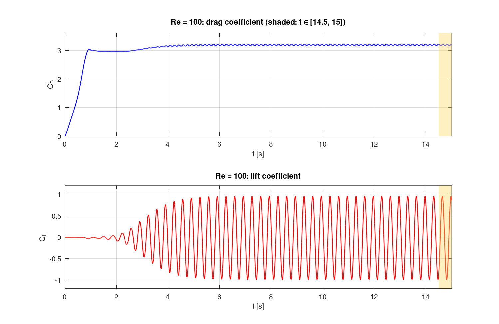
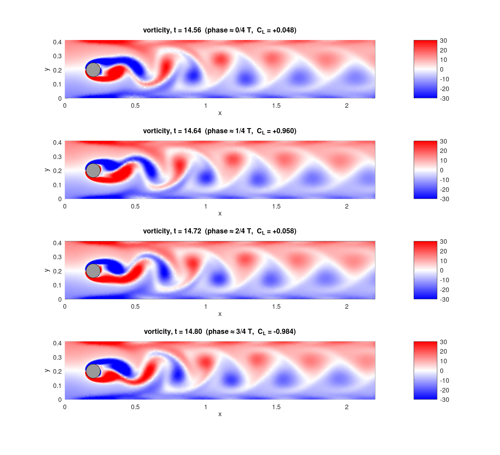
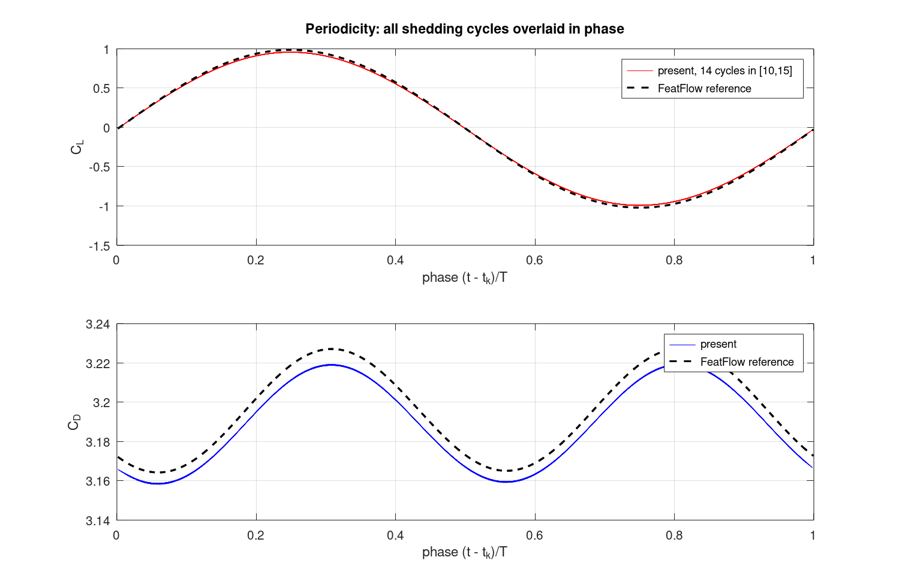

# 1 — 圆柱绕流 Re = 100 单工况基础算例（redbKIT）

复现 `../yuanzhuraoliu_LSTM.md`（Conti, Guo, Manzoni, Hesthaven, *Multi-fidelity surrogate modeling using LSTM networks*, CMAME 2023）第 5 节的 CFD 数据生成模型，只计算单工况 $Re=100$，**HF 设置**。目标是确认求解器能产生正确的流场、尾涡、升阻力系数，并且这些量呈周期性。

## 1. 问题设置（与论文一致）

| 项目 | 设置 |
|---|---|
| 方程 | 非定常不可压 N–S：$\rho\,\partial_t\mathbf v+\rho\,\mathbf v\cdot\nabla\mathbf v-\nabla\cdot\boldsymbol\sigma=0,\ \nabla\cdot\mathbf v=0$，$\boldsymbol\sigma=-p\mathbf I+2\nu\boldsymbol\epsilon(\mathbf v)$ |
| 区域 | $\Omega=(0,2.2)\times(0,0.41)\setminus B_r(0.2,0.2)$，$r=0.05$ |
| 物性 | $\rho=1$，$\nu=0.1/Re=10^{-3}$ |
| $\Gamma_{D_1}$（上下壁面、圆柱） | 无滑移 $\mathbf v=\mathbf 0$ |
| $\Gamma_{D_2}$（入口 $x=0$） | $\mathbf h=\big(4U(t)\,y(0.41-y)/0.41^2,\,0\big)$；$t<1$ 时 $U(t)=0.75(1-\cos\pi t)$，$t\ge1$ 时 $U(t)=1.5$ |
| $\Gamma_N$（出口 $x=2.2$） | $\boldsymbol\sigma\mathbf n=\mathbf 0$ |
| 初值 | $\mathbf v(\mathbf x,0)=\mathbf 0$ |
| $Re$ | $Re=U_{mean}\,2r/\nu$，其中 $U_{mean}=2\cdot1.5/3=1$，故 $Re=100$ |
| 系数 | $C_D=\dfrac{2F_x}{\rho U_{mean}^2D}$，$C_L=\dfrac{2F_y}{\rho U_{mean}^2D}$，$D=0.1$ |
| 离散 | redbKIT `NSt_Solver`：P2–P1 Taylor–Hood 有限元，BDF2，每步全隐式 Newton（tol $10^{-8}$），$\Delta t=0.01$（论文 HF），$T=15$ |
| 网格 | redbKIT DFG 基准网格 `mesh/obstacleDFG.msh`：15 968 个三角形，32 446 个 P2 节点，71 201 个自由度 |

> 论文中 $C_D$、$C_L$ 写作 $2|F|/(\rho U_{mean}^2)$，这里省略了特征长度 $D$；本算例采用 DFG 基准的标准定义（除以 $D$）。$C_L$ 保留正负号，便于分析周期性；论文中的 $|C_L|$ 等于 `abs(C_L)`。

## 2. 文件说明

| 文件 | 作用 |
|---|---|
| `main_cylinder_Re100.m` | 主程序：设置路径和参数、读入网格、求解、保存结果，然后调用后处理 |
| `datafile_cylinder_Re100.m` | redbKIT 数据文件，包含物性、边界条件、入流曲线、BDF 和输出设置 |
| `NSt_Solver_snap.m` | redbKIT `NSt_Solver.m` 的副本，只增加了 $t\ge14.5$ 时保存流场快照的功能，并加入时间循环舍入保护 |
| `load_msh_2D.m` | gmsh v2 网格读取器，输出与 `msh_to_Mmesh` 相同。redbKIT 的 `read_msh` 仅以 P-code 提供，Octave 无法运行 |
| `postprocess_cylinder_Re100.m` | 后处理：$C_D$/$C_L$ 曲线、周期与 $St$、FFT、相位叠加、参考值对比、流场和涡量图 |
| `octave_compat/verLessThan.m` | 仅在 Octave 下加入路径的兼容函数 |
| `setup_and_run_octave.sh` | Linux + Octave 一键脚本：下载 redbKIT、编译 MEX、运行 |
| `mesh/` | 网格（`.geo`、`.msh`），物理标记：1 入口、2 出口、3 上下壁、4 圆柱 |
| `reference/bdforces_q2_lv6_dt4` | FeatFlow DFG 2D-2 参考力系数（随 redbKIT 提供） |
| `results/` | 全部计算结果，见第 4 节 |

## 3. 运行方法

**MATLAB**
```matlab
% 1) 下载 https://github.com/redbKIT/redbKIT ，在其根目录运行一次  >> make
% 2) 在本目录下：
setenv('REDBKIT_PATH', '/path/to/redbKIT');   % 或修改 main 中的 REDBKIT_PATH
main_cylinder_Re100
```
**GNU Octave（本次实际运行方式）**：`bash setup_and_run_octave.sh /path/to/redbKIT`

本次运行环境：Octave 8.4，redbKIT commit `59b8ba9`，2 核 CPU。1500 个时间步共用时 **2.1 h**，日志见 `results/run_log.txt`。

## 4. 结果

### 4.1 升阻力系数与周期性（$t\in[10,15]$，共 14 个完整周期）

| 量 | 本算例 | FeatFlow 参考 | DFG 2D-2 基准范围 (Schäfer & Turek 1996) | 相对偏差（相对 FeatFlow） |
|---|---|---|---|---|
| $C_{D,\max}$ | **3.2195** | 3.2274 | [3.22, 3.24] | −0.25 % |
| $C_{D,\min}$ | 3.1582 | 3.1643 | – | −0.19 % |
| $\overline{C_D}$ | 3.1897 | 3.1959 | – | −0.19 % |
| $C_{L,\max}$ | **0.9600** | 0.9866 | [0.99, 1.01] | −2.7 % |
| $C_{L,\min}$ | −0.9947 | −1.0213 | – | −2.6 % |
| $St=fD/U_{mean}$ | **0.2979** | 0.3018 | [0.295, 0.305] | −1.3 % |

周期性检查：
- 涡脱落周期 $T=0.33567$，14 个周期之间的标准差为 $8\times10^{-6}$。
- 频率 $f=2.979$ Hz。FFT 得到 $f_D/f_L=2.00$，即阻力以两倍升力频率振荡，符合涡街规律。
- $\max|C_L(t)-C_L(t+T)|=3\times10^{-5}$，$\max|C_D(t)-C_D(t+T)|=1\times10^{-4}$。各周期峰值的离散度为 $10^{-5}$ 到 $10^{-4}$ 量级，说明流动已进入稳定的周期极限环。

偏差分析：$C_{D,\max}$ 和 $St$ 都在 DFG 基准范围内。$C_{L,\max}$ 偏低约 2.7%，主要原因是 BDF2 在 $\Delta t=0.01$（约 33 步/周期）下有数值耗散，参考解使用的时间步长远小于此。这与论文 HF 模型（$\Delta t_{HF}=0.01$）的精度级别一致。若要更接近基准值，可把 `CYL_CFG.dt` 改为 0.0025 或 0.002，计算量会相应增加。

### 4.2 结果文件（`results/`）

| 文件 | 内容 |
|---|---|
| `AerodynamicForces_Re100.txt` | 全时程 $t, C_D, C_L$，$\Delta t=0.01$，$t\in[0,15]$ |
| `CD_CL_Re100_t14.5-15_26pts.csv` | 论文所用窗口 $[14.5,15]$ 上 26 个等距时刻的 $C_D$、$C_L$ |
| `summary_Re100.txt` | 上表统计量 |
| `flowfield_Re100.mat` | 网格和 $t\in[14.5,15]$ 内 26 个时刻的 $u_x,u_y,p$（P1 顶点） |
| `run_log.txt` | 求解日志（各步 Newton 收敛情况） |
| `fig1_CD_CL_history_0-15.png` | $C_D(t)$、$C_L(t)$ 全时程：启动、失稳、进入周期 |
| `fig2_CD_CL_window_14.5-15.png` | $[14.5,15]$ 窗口及 26 个采样点 |
| `fig3_cycles_overlay_vs_reference.png` | 14 个周期按相位叠加，并与 FeatFlow 参考对比 |
| `fig4_spectrum_limit_cycle.png` | 频谱与 $(C_L,C_D)$ 极限环 |
| `fig5_mesh*.png` | 网格 |
| `fig6_*_t15.png` | $t=15$ 时的 $\lvert\mathbf v\rvert$、$u_x$、$u_y$、$p$、涡量 $\omega_z$ |
| `fig7_vorticity_4phases.png` | 一个周期内 4 个相位的涡量，可见卡门涡街交替脱落 |
| `fig8_wake_probes.png` | 尾流测点横向速度时程 |





## 5. 结论

redbKIT（P2–P1 + BDF2）按论文几何和边界条件计算 $Re=100$ 圆柱绕流，得到以下结果：
1. 流场合理：圆柱前有驻点高压区，两侧有加速区，尾迹中形成交替的正负涡，即卡门涡街。
2. 升阻力系数在约 $t\approx5$ 后进入稳定周期振荡。$C_D$ 振荡频率为 $C_L$ 的两倍，$St\approx0.298$。
3. 主要指标与 DFG 2D-2 基准吻合，$C_D$ 和 $St$ 误差小于 1.5%，$C_L$ 振幅误差约 3%。

因此可以作为后续多工况 $Re\in[70,160]$（LF/HF）数据生成的基础。
